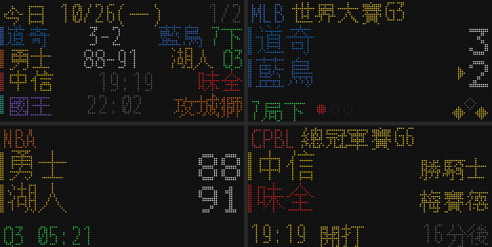

# BallLED 點陣比分看板（中職／MLB／NBA／TPBL／PLG）

用 ESP32 + HUB75 全彩 LED 點陣面板做的桌上比分看板。它會顯示今天你追蹤的球隊有哪些比賽，比賽進行中每 2 秒更新一次比分（中職官網是 5 秒，改用野球革命時是 10 秒）。棒球還會顯示安打數和失誤數（RHE）。



> 上圖是用 `--demo` 假資料產生的 LED 模擬圖，只用來看版面，不是真實比分。

## 架構

```
 ┌──────────── 伺服器（樹莓派／家裡電腦／NAS，常開） ────────────┐
 │  抓資料：中職官網、MLB Stats API、ESPN(NBA)、TPBL API、PLG 官網  │
 │  整理成統一格式 → 依追蹤清單篩選 → 用點陣中文字型畫成 128×64 圖 │
 │  GET /frame?page=N  → 16KB RGB565 原始畫面                       │
 └───────────────────────────────┬──────────────────────────────────┘
                                 │ 區網 HTTP
 ┌───────────────────────────────▼──────────────────────────────────┐
 │  ESP32（Trinity）→ HUB75 → 兩片 64×64 LED 面板（128×64）        │
 └──────────────────────────────────────────────────────────────────┘
```

**為什麼要另外跑一個伺服器？** 繁體中文字型有好幾 MB，ESP32 放不下完整字集；五個聯盟的資料來源有的是 JSON、有的要解析 HTML、有的要先拿驗證 token，在 ESP32 上寫會很痛苦，官網一改版還得重新燒錄。改成在伺服器端把畫面畫好再傳過去，韌體只要負責「抓圖、顯示」，之後要修正資料來源或調整版面，都只要改伺服器的 Python。

## 硬體清單

> 價格是 2026 年 10 月查到的海外通路標價（美元），台幣只是概算，不含運費與關稅。台灣蝦皮／露天的賣場價格請自行比較。

| 項目 | 推薦規格 | 數量 | 參考價 | 備註 |
|---|---|---|---|---|
| LED 點陣面板 | **P3 64×64 全彩 HUB75E（1/32 掃描，室內型）** | 2 | Waveshare 官網 US$29.99／片；AliExpress 雜牌約 US$8–16 | 單片 19.2×19.2 cm，兩片並排是 **38.4×19.2 cm、128×64 點** |
| 控制板 | **ESP32 Trinity**（Brian Lough 設計） | 1 | Tindie 原作者賣場 US$40；也可以找 Makerfabs 或 esp32s.com（US$46.90） | 直接插在面板背面，內建 DC 插孔和電源端子，是專為這個 LED 函式庫設計的板子 |
| 電源 | **5V 8A 以上**、2.1mm DC 插頭的變壓器（筆電型） | 1 | 約 NT$300–500 | Trinity 官方建議用 5V 8A。一片 64×64 大約要 4A，兩片要 8A 以上 |
| 排線／電源線 | 面板通常會附 HUB75 排線和電源線 | — | — | 兩片串接要用一條 HUB75 排線（第一片 OUT → 第二片 IN） |
| 伺服器 | Raspberry Pi Zero 2 W／Pi 4，或任何一直開著的電腦 | 1 | — | 開發階段用自己的電腦就可以 |
| 掛牆 | M3 磁鐵柱 ×8、鍍鋅鐵扁條 ×2、螺絲壁虎或 3M VHB | — | — | 見下方「掛牆（磁吸版）」 |
| 選配 | 黑色半透明壓克力板 | — | — | 蓋在面板前面，對比會好很多（訂製圖在 `docs/acrylic/`） |

### 淘寶買得到的組合（推薦）

控制板和面板都是**微雪電子（Waveshare）**出的，同一家的產品相容性最有保障。微雪在淘寶有官方店，可以用下表的關鍵字搜尋（實際有沒有貨、價格多少，以賣場為準）：

| 項目 | 商品 | 數量 | 淘寶搜尋關鍵字 | 海外標價參考 |
|---|---|---|---|---|
| 控制板 | **微雪 ESP32-S3-RGB-Matrix 驅動板**（ESP32-S3-WROOM-2，16MB PSRAM） | 1 | `微雪 ESP32-S3-RGB-Matrix` | US$24.99 |
| 面板 | **微雪 RGB-Matrix-P3-64x64**（3mm 間距，64×64，1/32 掃描） | 2 | `微雪 RGB-Matrix-P3-64x64` | US$29.99／片 |
| 電源 | 5V **8A 以上**開關電源，或 5V 10A 變壓器 | 1 | `5V10A 开关电源` 或 `明纬 LRS-50-5` | — |
| 線材 | HUB75 16P 排線（面板通常有附）、面板電源線 | — | `HUB75 16P 排线` | — |

- 韌體選 `waveshare_s3`：`pio run -e waveshare_s3 -t upload`。腳位是照微雪文件寫的，E 腳是 GPIO 9。
- 這塊板子有 16MB PSRAM，記憶體比一般 ESP32 寬裕很多，128×64 雙緩衝不會有問題。
- 燒錄方式：按住 BOOT 再插 USB-C，放開 BOOT 後上傳，完成後按 RESET。
- 每片面板都要各自接 5V 電源（電源不會沿著排線傳到下一片）。微雪建議每片抓 4A，兩片就是 8A。

**更便宜的淘寶組合（要自己確認規格）：**

- 控制板：一般 **ESP32-WROOM-32 開發板（30P，不是 C3／S2）**，加一塊「ESP32 HUB75 轉接板」，或用杜邦線照下面的「接線」自己接。韌體選 `esp32dev`，E 腳接 GPIO 18。轉接板要確認是給 **64×64** 用、有接 E 腳的版本，有些只支援 64×32。
- 面板：淘寶搜尋 `P3 全彩单元板 64x64 室内 1/32扫`。注意不要買到 1/16 掃描的戶外板。
- 一般 ESP32 沒有可以給這個函式庫用的 PSRAM，128×64 有可能放不下雙緩衝。韌體會自動改用單緩衝，換頁時可能會稍微閃一下。

**買面板時要注意：**

- 一定要選 **HUB75E**（有 E 位址線）、**1/32 掃描**的 64×64 面板。
- 看賣場有沒有寫驅動晶片。這個 LED 函式庫測試過可以用的有 **FM6126A、FM6124、ICN2038S、ICND2012、RUC7258、SM5266P**。常見的 ICN2037 是一般的移位暫存器，通常也能用。**不支援 ICN2053、FM6353 這類 S-PWM 晶片**，買到這種是不能用的。下單前可以先問賣家用的是哪一顆。
- 第一次買、不想踩雷的話，可以挑 **Waveshare 的 RGB-Matrix-P3-64x64**，品牌貨規格比較清楚。

**為什麼不推薦 Adafruit MatrixPortal S3？** 它本來是最方便的選擇，但這個專案用的 LED 函式庫（ESP32-HUB75-MatrixPanel-DMA），作者在說明裡寫了「MatrixPortal S3 搭配這個函式庫可能有 WiFi 干擾問題，需要 WiFi 的話不建議使用」。看板一定要靠 WiFi 抓比分，所以改推薦 Trinity。另外，MatrixPortal S3 目前在 Adafruit 官網和 DigiKey 都缺貨，DigiKey 標示的交期是 18 週。韌體還是保留了 `matrixportal_s3` 這個 env，已經有這塊板子的話也能用用看。

**其他尺寸的面板：**

- **P2.5 64×64**：一片 16×16 cm，兩片並排 32×16 cm，點距更細、更精緻。
- **P4 64×32**：一片 25.6×12.8 cm，實體比較大，但兩片只有 128×32 點，中文只能排兩行。目前的版面是照 128×64 設計的，用 128×32 要另外調整 `render.py`。

### 接線

1. 兩片面板背面的箭頭要朝同一個方向。Trinity 插在左邊那片的 **HUB75 IN**，左邊那片的 **OUT** 再用排線接到右邊那片的 **IN**。
2. 5V 變壓器插 Trinity 的 DC 插孔。兩片面板的電源線（紅 5V、黑 GND）接到 Trinity 的綠色電源端子。
3. **64×64 面板需要 E 位址線**：Trinity 用的是 GPIO 18（和 Trinity 官方範例一樣），韌體已經設定好了。
4. 一般 ESP32 DevKit 自己接線的話，用函式庫的預設腳位：R1 25、G1 26、B1 27、R2 14、G2 12、B2 13、A 23、B 19、C 5、D 17、**E 18**、LAT 4、OE 15、CLK 16。
5. 如果用的是 MatrixPortal S3：背面的「Address E」跳線要焊到 **8**（Adafruit 自家面板）或 **16**（部分其他廠牌），依面板規格決定。另外，板子上的電源端子只能輸出，面板要另外接 5V 電源。

### 掛牆（磁吸版）

這是 LED 顯示屏業界固定模組的做法：牆上鎖兩根鐵條，面板背後鎖磁鐵柱，整片直接吸上去。

```
牆 ── 鐵條 ×2（水平，螺絲或 3M VHB 固定）
        ↑ 磁吸
      磁鐵柱 ×8（M3 螺紋，鎖在面板四角的 M3 孔；不夠高就先加一節 M3 銅柱）
        │
      LED 面板 ×2
```

- **鐵條要用鐵**，鋁吸不住。建議寬 25mm、厚 2–3mm、長約 360mm（比看板短，掛上去看不到）。
- **兩根鐵條的間距**等於面板上下兩排磁鐵柱的中心距離，面板到了再實際量。
- **磁鐵柱（加銅柱）的總高度**要比面板背後最高的東西（接頭、驅動板）再高約 5mm，只讓磁鐵柱碰到鐵條。
- **鐵條上的螺絲**要鎖在磁鐵柱之間，螺絲頭剛好在磁鐵吸的位置的話，磁鐵會貼不平。
- **吸力很夠**：一顆 Ø12mm 磁鐵柱的抗滑力約 700g，8 顆約 5.6kg；看板只有 0.6–0.8kg。
- **驅動板**用雙面泡棉膠貼在面板 1 背後、上下兩排磁鐵柱之間。

微雪的 64×32 面板有附磁吸螺絲，64×64 的官方清單沒寫清楚，到貨時先看包裝裡的「螺絲包」是不是磁鐵柱。

## 軟體

### 1. 伺服器（先在自己的電腦跑）

```bash
cd server
python3 -m venv .venv && source .venv/bin/activate   # Windows: .venv\Scripts\activate
pip install -r requirements.txt
cp config.example.yaml config.yaml                   # 編輯你要追蹤的球隊

# 字型（Raspberry Pi / Ubuntu）
sudo apt install fonts-wqy-zenhei fonts-unifont
```

先不用硬體，看看畫面長什麼樣子：

```bash
python -m scoreboard preview --demo     # 假資料，看版面
python -m scoreboard preview            # 抓今天的真實資料
# 輸出在 preview/ 資料夾：page0_overview.png、page1_game.png ...
```

確認各聯盟資料來源能不能抓：

```bash
python -m scoreboard probe              # 全部聯盟
python -m scoreboard probe cpbl --date 2026-10-26
# 原始回應會存在 probe/，官網改版時拿來對照欄位
```

啟動伺服器：

```bash
python -m scoreboard serve --port 8080
```

接著用瀏覽器開 `http://localhost:8080/`，就能看到目前輪播的每一頁（每 10 秒自動更新）。

| 網址 | 用途 |
|---|---|
| `/` | 網頁預覽所有頁面 |
| `/frame?page=N` | 給 ESP32 用的 RGB565 原始畫面（標頭帶 `X-Pages`、`X-Hold-Ms`、`X-Brightness`） |
| `/api/games` | 今天的比賽（JSON） |
| `/api/status` | 各聯盟最後更新時間與錯誤訊息 |
| `POST /api/refresh` | 立刻重抓 |

**放到樹莓派常駐**（systemd）：

```ini
# /etc/systemd/system/scoreboard.service
[Unit]
Description=Scoreboard
After=network-online.target

[Service]
WorkingDirectory=/home/pi/scoreboard/server
ExecStart=/home/pi/scoreboard/server/.venv/bin/python -m scoreboard serve --port 8080
Restart=always

[Install]
WantedBy=multi-user.target
```

```bash
sudo systemctl enable --now scoreboard
```

### 2. 韌體（ESP32）

1. 安裝 [VS Code + PlatformIO](https://platformio.org/install/ide?install=vscode)。
2. 打開 `firmware/` 資料夾。面板尺寸不同的話，先改 `include/config.h`。順便把 `platformio.ini` 裡 `[ota]` 的 `password` 改成你自己的無線更新密碼。
3. 用 USB-C 接上驅動板燒錄：
   - 微雪 ESP32-S3-RGB-Matrix：`pio run -e waveshare_s3 -t upload`（按住 BOOT 再插 USB-C，放開後上傳，完成後按 RESET）
   - Trinity：`-e trinity`；一般 ESP32：`-e esp32dev`；MatrixPortal S3：`-e matrixportal_s3`
4. 第一次開機時，面板會顯示 `Scoreboard-XXXX`。用手機連上這個 WiFi，在跳出的頁面選擇家裡的 WiFi，並填入**伺服器網址**（例如 `http://192.168.1.100:8080`）。
5. 之後想重新設定，就在開機時按住 **BOOT** 鍵。

### 3. 無線更新韌體（OTA）

第一次用 USB 燒錄之後，看板掛上牆就不用再拆下來，之後可以直接透過 WiFi 更新韌體：

```bash
pio run -e waveshare_s3_ota -t upload    # 其他板子：trinity_ota / esp32dev_ota / matrixportal_s3_ota
```

- 電腦和看板要在同一個 WiFi 網路。
- 更新時面板會顯示 `OTA UPDATE` 和進度條，完成後自動重新開機。
- 預設用 `scoreboard.local` 找到看板。Windows 有時候找不到，這時把 `platformio.ini` 的 `[ota] host` 改成看板開機時顯示的 IP（`WiFi OK` 下面那行）。建議在路由器設定裡幫看板固定一個 IP。
- 面板顯示 `OTA FAIL wrong password`：表示 `platformio.ini` 的密碼和看板上的不一樣。改密碼之後，要先用 USB 燒錄一次，新密碼才會生效。
- 分割表（Flash 的空間配置）只能用 USB 改。我已經幫 OTA 預留好兩份韌體的空間，第一次 USB 燒錄時就會寫進去。
- 版面、球隊、資料來源都在伺服器端處理，改這些**完全不用更新韌體**。只有改到 `firmware/` 裡的程式才需要 OTA。

如果用 MatrixPortal S3，板上的 **UP** 鍵可以切到下一頁，**DOWN** 鍵可以暫停輪播、固定顯示目前這場（比分仍會持續更新）。

### 4. 整點報時（喇叭）

微雪 ESP32-S3-RGB-Matrix 驅動板有 ES8311 音訊晶片和喇叭，可以在整點播放一段音檔。預設時段：

- 平日 09:00～20:00 每個整點（12 次）
- 假日（週六、週日，以及 `holidays` 列出的日子）12:00～20:00 每個整點（9 次）；`workdays` 列出的補班日照平日時段

設定方式：

1. 準備音檔（mp3、m4a、wav 都可以），放在 `server/` 資料夾，檔名預設 `chime.mp3`。
2. 伺服器要能轉檔：`sudo apt install ffmpeg`（Windows／macOS 也要安裝 ffmpeg；沒有 ffmpeg 時只能用 16-bit 的 wav 檔）。
3. `config.yaml` 打開 `chime.enabled: true`，可以調整 `volume`（0-100）和時段。改完重開伺服器即可，**不用重新燒錄韌體**。
4. 測試音量：`curl -X POST http://伺服器IP:8080/api/chime/test`，看板下一次抓畫面時（幾秒內）就會播放。
5. `/api/status` 的 `chime` 欄位會顯示下一次報時時間；音檔有問題時也會在這裡顯示錯誤。

運作方式：伺服器把音檔轉成 48kHz 單聲道 PCM，看板下載一次存在 PSRAM（最長約 40 秒；`max_seconds` 預設只播前 20 秒）。每次抓畫面時，伺服器會告訴看板「距離下一次報時還有幾毫秒」，看板自己倒數，時間一到就在背景播放，畫面不會停。其他沒有喇叭的板子會忽略這個功能。

## 輪播規則

- 五個聯盟都會持續抓資料，**當天有比賽的聯盟才會出現在輪播裡**。籃球季時自然只會輪到籃球，棒球季時只會輪到棒球，兩邊都有比賽的日子就全部一起輪播，不用手動切換。
- **輪播順序**：總覽（第 1–4 場）→ 第 1–4 場的單場頁 → 總覽（第 5–8 場）→ …… 依開打時間固定排序，比分或狀態改變也不會重排，所以比賽再多，每一圈每一場都一定會輪到一次。
- 比賽進行中的單場頁停 12 秒，其他頁停 8 秒。打開 `/api/status` 可以看到目前輪播一圈要多久（`cycle_seconds`）。
- 當天沒有任何比賽時，只顯示時鐘頁。
- 所有聯盟的 `teams` 預設是空的，代表每一場都顯示。只想看特定球隊的話，再填進去。

## 畫面說明

- **總覽頁**：今天所有追蹤中的比賽，每列一場。左邊色條代表聯盟，接著是客隊、比分（未開打就顯示開打時間）、主隊、狀態（`7下`、`Q3`、`終`）。
- **單場頁**：第一列是聯盟、賽事名稱（總冠軍賽G6、世界大賽G3）和場地；中間是兩隊與大字比分。上面是客隊、下面是主隊，和官方記分板的順序一樣。
  - 棒球比賽中：會顯示局數、出局燈、壘包，進攻方比分旁有黃色小三角形。
  - 未開打：會顯示開打時間、倒數時間和先發投手。
  - 終場：輸球那隊會變暗。
- **沒比賽時**：顯示大時鐘和日期。
- 夜間（預設 23:30–07:00）自動調暗；有比賽進行中時則維持正常亮度。

## 資料來源

| 聯盟 | 來源 | 穩定度 |
|---|---|---|
| MLB | `statsapi.mlb.com`（MLB 官方 Stats API） | 高，免金鑰 |
| NBA | ESPN `site.api.espn.com` scoreboard | 高，非官方但已經用了很多年 |
| 中職 | 主要：中職官網 `cpbl.com.tw` 的 `/schedule/getgamedatas`（賽程）與 `/box/getlive`（比分、RHE、局數、出局、壘包）；備援：野球革命 Rebas `rebas.tw/api` | 中，官網前端使用的 JSON，未公開文件化。**官網只有台灣的網路連得上**，從國外機房會被 HiNet CDN 回 404，這時會自動改用野球革命 |
| TPBL | `api.tpbl.basketball`（官網前端使用的 API） | 中，未公開文件化 |
| PLG | `pleagueofficial.com` 賽程頁 HTML ＋ `/api/boxscore.preciser.php` | 中低，解析 HTML，官網改版就要調整 |

所有來源都是公開網頁背後的資料，請保持合理的更新頻率。預設比賽中 2 秒、30 分鐘內要開打 1 分鐘、平時 10 分鐘：

- 只有「有比賽進行中」的聯盟會用 2 秒，其他聯盟照樣 10 分鐘才抓一次。
- 中職官網的單場資料每次都包含整場的逐球紀錄，所以最快 5 秒一次；改用野球革命時，每次都要下載整季資料（約 500KB），最快 10 秒一次。設定再小也不會更快。
- 想個別調整可以在 `config.yaml` 寫 `leagues.nba.live_seconds: 5` 這樣。
- 2 秒只是我們去問的頻率，比分多快出現還是要看資料來源自己多久更新一次。
- 看板停在進行中比賽的頁面時，也會每 2 秒重抓一次畫面（`poll.screen_refresh_seconds`），不用等輪播一圈回來才看到新比分。

> ✅ MLB、NBA、TPBL、中職（野球革命）都已經在 GitHub Actions 上用真實資料驗證過。中職官網只能從台灣連線，已確認在家裡的網路可以取得 `/schedule/getgamedatas` 與 `/box/getlive`；解析程式是依照欄位清單寫的，第一次在家跑 `python -m scoreboard probe cpbl` 時請確認狀態和 RHE 是否正確。
>
> ⚠️ **PLG 官網有 Cloudflare 驗證**，從雲端主機連會被擋（HTTP 403）。請在家裡的網路跑 `python -m scoreboard probe plg` 確認；如果家裡也被擋，PLG 只能先關閉（`leagues.plg.enabled: false`）。本專案不會去繞過網站的機器人驗證。
>
> 任何聯盟抓不到或欄位不對時，跑 `python -m scoreboard probe`，`probe/raw/` 裡的原始回應可以拿來修正 `server/scoreboard/leagues/` 底下對應的檔案。

## 測試

```bash
cd server && python -m pytest -q
```

## 疑難排解

| 狀況 | 處理 |
|---|---|
| 面板只亮一半、或上下重複 | 64×64 面板的 E 腳沒接好：Trinity／一般 ESP32 要接 GPIO18，MatrixPortal 要焊 Address E 跳線（8 或 16） |
| 開機時序列埠印出 `fallback to single buffer` | 一般 ESP32 的記憶體不夠開雙緩衝，已經自動改用單緩衝，換頁時可能會稍微閃一下，不影響使用 |
| 開機全黑或花屏 | 打開 `config.h` 的 `PANEL_DRIVER_FM6126A` |
| 顏色或左右錯位 | 切換 `PANEL_CLKPHASE` |
| 面板顯示 `NO SERVER` | 確認伺服器網址、電腦防火牆有開 8080 埠，以及 ESP32 和伺服器在同一個網段 |
| 某聯盟沒有資料 | 開 `/api/status` 看錯誤訊息，再跑 `python -m scoreboard probe <聯盟>` |
| 隊名縮寫不對 | 在 `config.yaml` 的 `aliases` 裡覆寫，或修改 `scoreboard/teams.py` |
